# SORA Sled Setup for Arctic Trucks

Setup instructions revision: 1  
Last updated: 2026-11-22

Thank you for building our radar! I've done what I can to make this as simple as possible, but things never look quite the same in the field as they do in a lab. If you have questions or run into any issues, please feel free to get in touch:

> Thomas Teisberg  
> +1-434-322-0360 (call, text, WhatsApp, Signal)  
> thomas.teisberg@astera.org

## Packing list

These are the packages you should have received.

| Item | Package type | Notes |
|---|---|---|
| SORA Radio Echo Sounder | Blue Pelican 1535 case | Prefer "do not freeze" for long term storage. (1) |
| 2x Jaybeam MVP300 "Skeleton Slot" Antennas | Blue Correx box | 6 mm allen key taped to inside lid of box. (And there's a spare in the duffel bag.) |
| Sled mounting and cables kit | Black REI duffel bag | See below for contents. |
| Siglin Freight Sled | Flat-packed in box | |

These items are travelling under an ATA Carnet, so it's important that we get every item back within 12 months. If things break, no worries (there are spares of the things most likely to) but please still send them back for customs purposes.

(1) This radar system has been deployed a few times (in Antarctica once, Greenland three times to date), but we've always treated the radar itself as "do not freeze." I don't think it's very practical for you to keep the radar warm continuously, so I'm happy to treat this as the experiment. It should survive being frozen OK. If you're going to store it for a long period of time and there is a non-frozen option, that's preferable.

The black duffel bag contains:

- SORA Sled mounting kit:
    - 2x foam platforms for radar
    - Tarp
    - 4x NRS strap - 9’
    - 4x NRS strap - 12’
    - 3x ratchet straps
- SORA Cables kit:
    - 2x M12 L to Anderson Power Pole (APP) power cable - 1.5 m (2nd one spare)
    - 2x APP power cable extension - 7 m
    - APP to ring terminals (for direct truck 12 V connection - alternative to the truck cab option)
    - 2x M12 X to RJ45 ethernet cable - 15 m (2nd one spare)
    - 2x M12 X ethernet cable extension - 5 m
- SORA Power supply:
    - 110-220 V AC to 12 V DC APP power adapter (wall plug for use in truck cab)
    - Inline power meter
    - Extra M12 L to APP power cable - 1.5 m (spare)
- SORA Antenna cables kit:
    - 4x SMA to N coax cables - 1.5 m (2 spare)
    - 4x SMA extension cables - 1.5 m
    - 2x N to SMA adapter (backup only)
- SORA Tools kit:
    - Extra coax cables
    - SMA torque wrench
    - Screwdriver kit
    - 6 mm allen key (for antennas)
    - SMA Attenuators and spare SMA pass-throughs
    - Desiccant packs
    - Stickers :)

### Leaving things behind

If you build the radar sled and assemble everything, it's possible for you to leave some of the kit behind. The antennas box can certainly be left behind once they're built or it can be flattened for storage. The black duffel bag contains a number of spare cables which may not be needed. If possible, I'd encourage you to take them with you.

## Before you start

Check to see if any of the three packages are obviously damaged from the outside.

Open the radar case. Compare it against the photos below and see if anything was obviously damaged in transit.

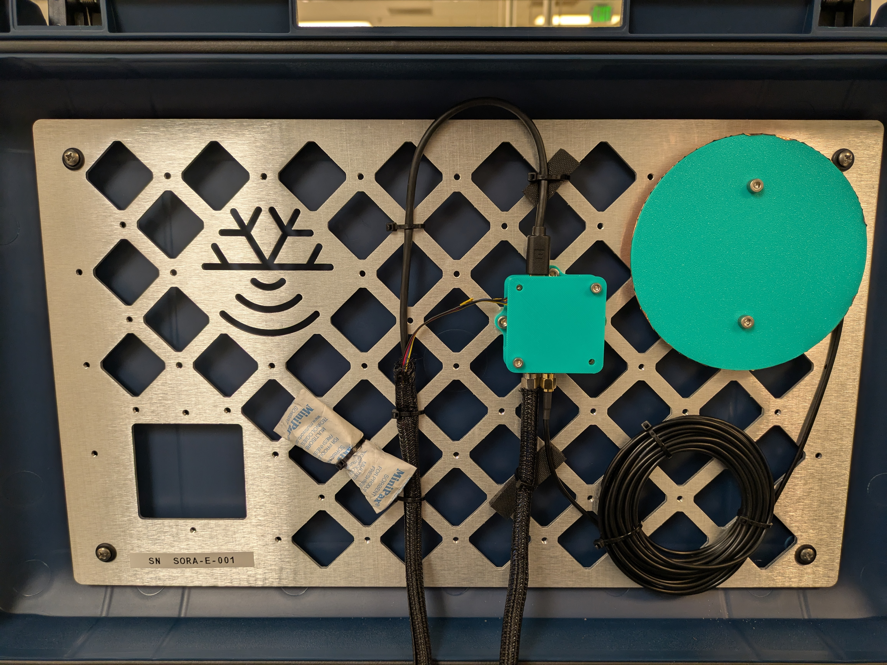
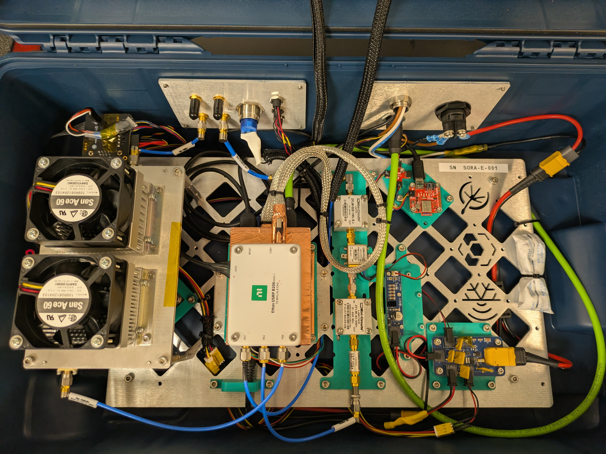

If possible, take a photo or two of the inside and send it to me for a double-check.

> Thomas Teisberg  
> +1-434-322-0360 (call, text, WhatsApp, Signal)  
> thomas.teisberg@astera.org

If anything appears to be damaged, please get in touch with me before proceeding.

> **Warming cables before use:** If you have a way to do so, please consider putting the cables you're going to use into a warm place for an hour or so before you assemble them. The coax cables in particular have a tendency to crack internally if they are bent/unbent while very cold. They can usually survive much colder temperatures when not bending.
>
> When connecting coax cables (to the antennas), take care to avoid sharp bends and protect cables from continuous flexing.

If you've got a spare Arctic Trucks sticker or similar, feel free to add it to the radar pelican case so we get your branding in any photos!

## Assembling the sled

The sled is a Siglin Freight Sled with spring pintles in front and back. It should be packed with instructions for assembly.

## Building the antennas

> Video option: Keith Nichols created a YouTube video showing the process. If you prefer that, it's here: <https://www.youtube.com/watch?v=6Wym5hujnFA>

There are two antennas packed together in the blue box. Each antenna comes in four parts:

1. Back reflector (the large "top" piece)
2. Active element (the "bottom" piece)
3. 2x side support struts

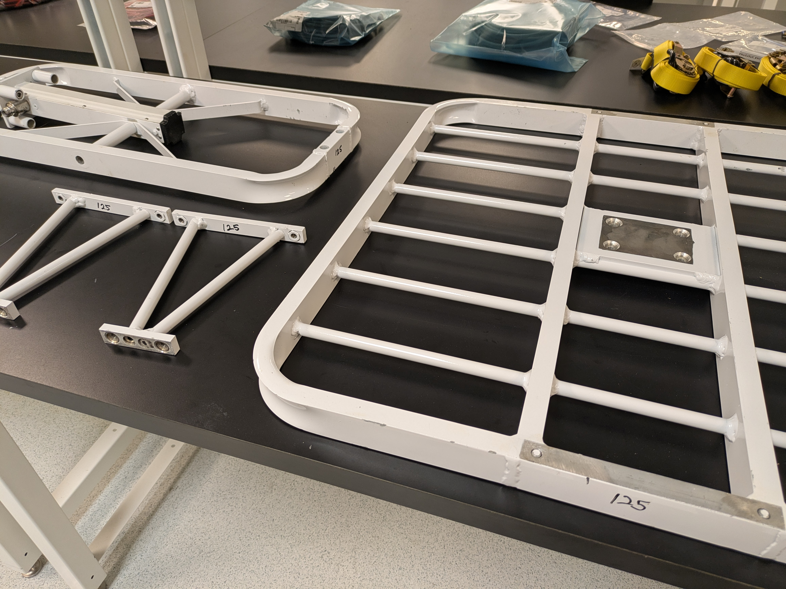

The two antennas are labelled with serial numbers 124 and 125. Each side strut and top and bottom piece is labelled with which antenna it belongs to.

The only tool required is a 6 mm allen key. There is one taped to the inside of the lid of the box. Just in case, there's a spare 6 mm allen key in the tool kit in the black duffel. All bolts are captive bolts contained in the pieces.

For each antenna:

1. Lay the back reflector (largest piece) down with the bolts sticking up
2. Look at the black lines on the two side supports to determine which one goes on which side of the back reflector
3. Loosely attach each of the side supports by screwing in the two captive bolts on each side of the back reflector
4. Gently fold the active element center column down to a 90 degree angle and place it on the back reflector, aligning the four bolt holes with the bolts on the back reflector and the marks on the side with the matching marks on the side supports.
5. Loosely secure the 4 bolts (2 per side) connecting the active element to the side supports and the four bolts connecting it to the back reflector
6. Double check that all parts have matching serial numbers and that the alignment marks on each side all match up.
7. Tighten all bolts

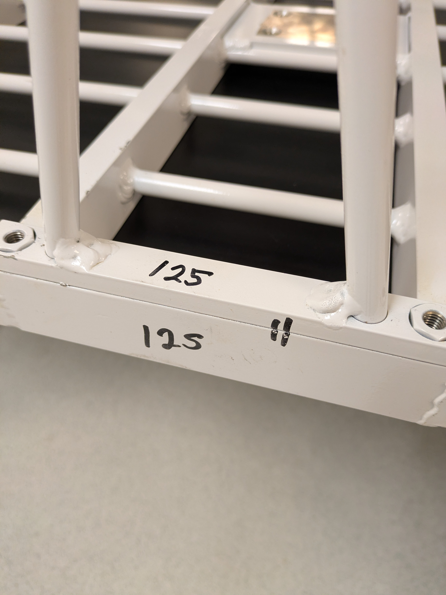
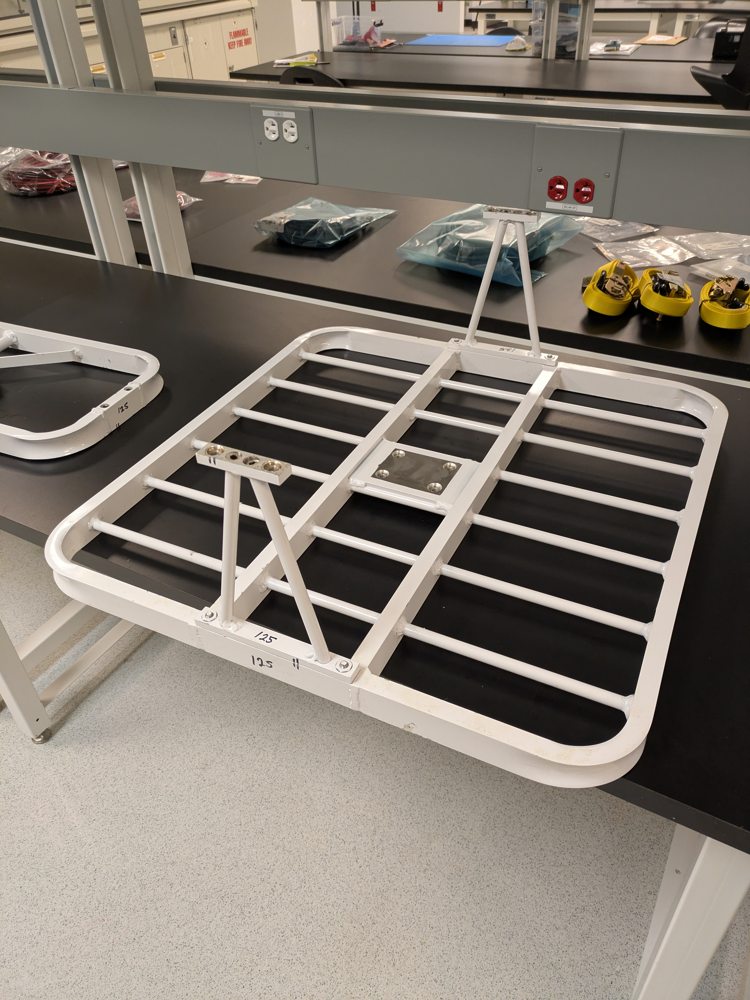
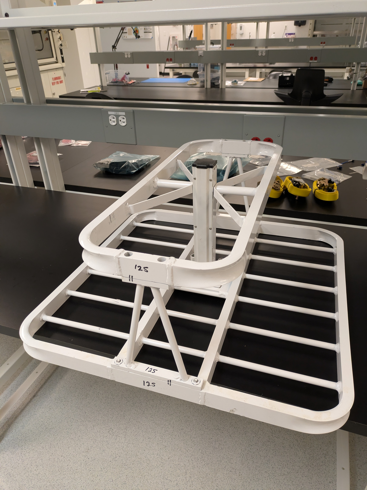

Note that the antenna needs to be oriented with the back reflector at the top and the tip of the active element pointing into the ground. There are foam pieces in the black duffel to support the antennas in this orientation. See the next section.

## Placement on the sled

1. The black duffel bag contains two pre-cut pieces of toolbox foam that have a hole for the active element protrusion to poke into and a partial cutout to fit the active element loop. Flip each antenna over (from the configuration you built them in) and place them into the slot in each foam pad.

    | Parts / tools | Where to find it |
    |---|---|
    | 2x assembled antennas | Built in the previous section |
    | 2x foam platforms | Black duffel |

    **Orientation:** The two antennas should be placed on the front and back of the Siglin sled, separated as far as practical. It is critical that the back reflector be at the top and the point of the active element facing into the ground.

    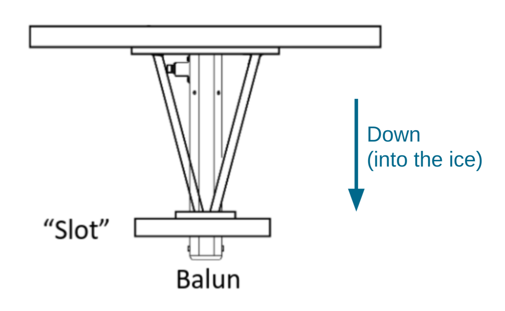

    The rotation of the active element loop is less critical. Ideally, the long axes of each active element loop should point towards each other, however a 90 degree rotation may be more convenient for fitting on the sled. Either is acceptable, but both antennas should be oriented the same way to avoid cross-polarization loss.

    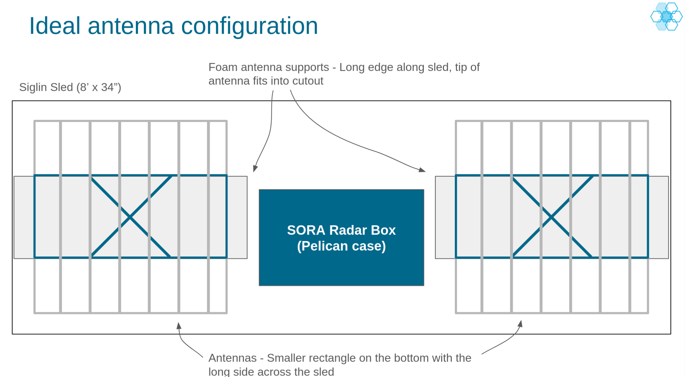

    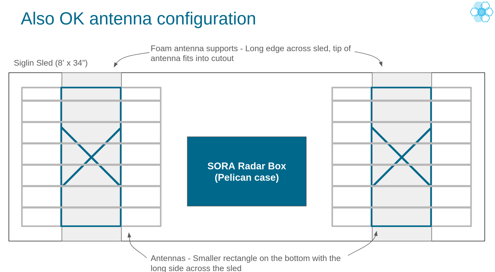

2. The radar box goes in the middle of the sled, between the two antennas. Put the long axis of the box along the long axis of the sled, offering easy access to the ports on the back of the sled.

    | Parts / tools | Where to find it |
    |---|---|
    | SORA radar box | Blue Pelican case |

3. Using your choice of ratchet straps or NRS straps (I prefer the NRS straps), loosely strap each element down. For the radar case, it may be useful to go through the handles to secure it.

    | Parts / tools | Where to find it |
    |---|---|
    | NRS straps or ratchet straps | Black duffel, SORA Sled mounting kit |

    Considerations here:

    - Avoid blocking the connectors on the back of the radar case
    - Make sure that the metal parts of the ratchet straps are not contacting any part of the antennas
    - If you need or want to use other items to help secure, try to avoid using anything metallic, liquid, or anything else that might be conductive.

4. **Connect the antenna cables**

    | Parts / tools | Where to find it |
    |---|---|
    | 2x SMA to N coax cables - 1.5 m | Black duffel, SORA Antenna cables kit |
    | SMA extension cables - 1.5 m (only if needed) | Black duffel, SORA Antenna cables kit |
    | SMA torque wrench | Black duffel, SORA Tools kit |

    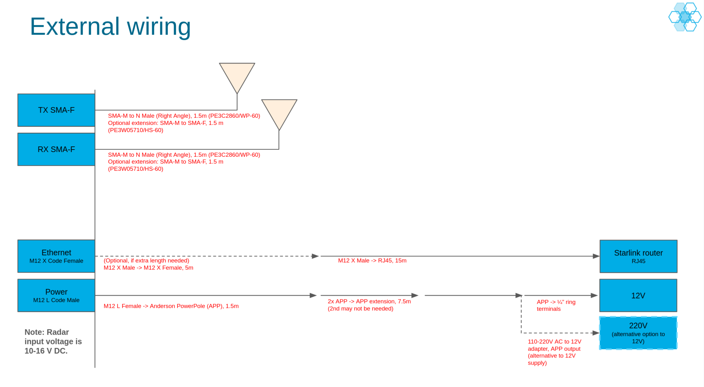

    Find the bag in the duffel labelled "SORA Antenna Cables Kit". It should contain:

    - 4x N type (the big end) to SMA cables
    - 2x SMA extension cables
    - 2x N type to SMA adapters

    Also grab the black and yellow tool kit from the duffel and find the blue SMA torque wrench wrapped in bubble wrap.

    Most likely, you will only need 2 of the N type to SMA cables. The rest are spares.

    Remove the metal connector caps from each antenna and screw the N type connector on. It should be finger tight (don't use a wrench). On the radar, the cables connect to the bottom two ports, which are labelled TX and RX. It does not matter which antenna is which.

    **Do NOT use the two ports labelled "NO CONNECTION".**

    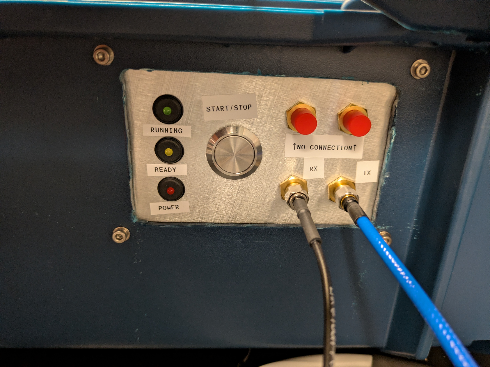

    The SMA cables should be torqued with the torque wrench until it bends. If you don't have the torque wrench (included in the tool kit) for some reason, finger tight is OK.

    Try to route the cable where it does not have to make any tight bends and won't flex too much during travel.

    If the cables are not long enough, you can use the SMA extension cables. These should also be torqued with the torque wrench.

5. **Connect the ethernet cable**

    | Parts / tools | Where to find it |
    |---|---|
    | M12 X to RJ45 ethernet cable - 15 m | Black duffel, SORA Cables kit |
    | M12 X ethernet cable extension - 5 m (only if needed) | Black duffel, SORA Cables kit |

    Find the bag labelled "SORA Cables kit for Arctic Trucks". To start find the bag labelled M12 Ethernet Cables. One side should be a circular connector and the other a standard RJ45 (normal household ethernet plug).

    Lay this cable out and determine if it's long enough to reach all the way from the radar to the Starlink router in the truck. It's a 15 meter cable.

    If it's not, find the bag labelled "M12 ethernet extension cables" and add in the extra 5 meters on the radar side (circular connector side).

    The ethernet port on the SORA radar is an M12 X-coded industrial circular connector labelled "ethernet". It is keyed and only goes in one way. Connect to the radar and connect the other side to your router in the truck.

    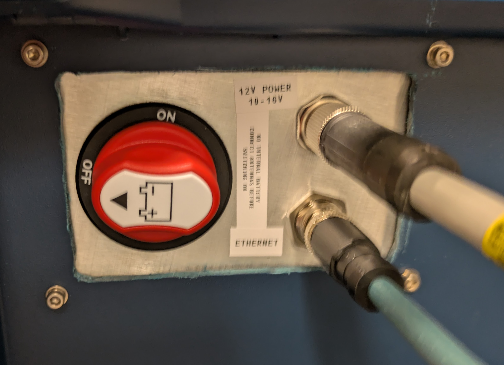

    Route the cable as needed. Whatever you're able to do to prevent excessive flexing during starts/stops is appreciated.

6. **Connect the power cables**

    | Parts / tools | Where to find it |
    |---|---|
    | M12 L to APP power cable - 1.5 m | Black duffel, SORA Cables kit |
    | APP power cable extensions - 7 m (as needed) | Black duffel, SORA Cables kit |
    | Option 1: AC to 12 V DC APP power adapter | Black duffel, SORA Power supply |
    | Option 2: APP to ring terminals cable | Black duffel, SORA Cables kit |

    Find the bag labelled "SORA Power cables kit". Within that bag, start with the "M12 to APP power cables" bag.

    Connect the M12 end to the other M12 port on the radar (labelled "12V Power" - also keyed to only go in one way).

    There is another bag labelled "APP extension cables". Use as many extensions as required to reach a power source on the truck. There are pins to secure the PowerPole connectors against vibration. A wrap of tape is also a good idea.

    Once you reach the truck, there are two options for providing power to the radar:

    **Power option 1:** The "SORA Power supply" box contains a standard AC inverter with both US and Euro plugs on one end and an Anderson PowerPole connector on the other. You can plug this into a 110-220 V AC outlet if you have one available.

    **Power option 2:** I've also included a short Anderson PowerPole to ring terminal cable. Feel free to cut this (or any of the power cables) to create a connector to whatever 12 V power source you have available.

    The power supply kit also contains an inline power meter if you want to see power draw. This isn't suitable for continuous outdoor use and is better suited to in-truck use. It's entirely optional.

7. **Double-check, power test, and photos**

    Check that all connections are tight and secure cables (with strain relief at connection points).

    At this stage, if possible, please take a few photos for me:

    - [ ] The entire sled, showing the position and orientation of each antenna
    - [ ] The connections to the radar box
    - [ ] One photo from the side of the radar case showing the Astera logo on the label card (this one is to keep the funders engaged :)
    - [ ] The best photo you can get showing the Arctic Trucks sticker (if you had one to put on) or the actual truck (this one is for you :)

    If you have questions about anything, feel free to reach out to me first.

    Once everything is set, you can rotate the switch on the back panel of the radar box. The red power light should turn on immediately. Within about two minutes, you should get a solid yellow ready light.

    The radar contains a small computer (a Raspberry Pi) and a supercapacitor backup power. This allows it to stay alive for about a minute after losing power to safely shut down. You can turn off the system by simply turning the switch off or cutting power from the truck, however **please try to avoid turning it off within 5 minutes of turning it on**. For the safe shutdown to work, the system needs to be fully booted and the capacitor bank needs to charge.

8. **Cover and secure**

    | Parts / tools | Where to find it |
    |---|---|
    | Tarp | Black duffel, SORA Sled mounting kit |
    | Remaining NRS or ratchet straps | Black duffel, SORA Sled mounting kit |

    The open frame "skeleton" antennas need to remain open -- without snow or anything else piling up inside. I've included a large tarp that should be able to cover over the entire sled.

    The tarp is 8 ft x 10 ft. With the 10 ft side along the long edge of the sled, wrap the tarp over the antennas and radar. The tarp is plastic and can be wrapped under the antennas and/or radar box. Secure the tarp with the remaining NRS or ratchet straps.

    You may want to leave the radar power switch and connections accessible without too much trouble.

9. **That's it!**

    If the radar is powered up and connected by ethernet to your router, I should get a notification when it comes online. From there, I can remotely control the radar system. If you're interested, let me know and I'll be happy to send you updates and previews of the data!

    If you're curious or in case offline operations are needed, feel free to check out the operations guide. If the remote link is working, this is optional.

THANK YOU so much for setting up the radar! I know that was a lot of work and you've probably got way too much to do already. I'm very excited to see what data we can collect together!

If you're able to send me some photos, please do. I would also welcome your feedback on how this setup worked and what improvements you'd like to see.

## Appendix A: Status LEDs and manual operations

You should not need any of this. If the Starlink connection works, I'll control the radar remotely and the lights are just for information. This is here in case the remote link is down and we agree that you'll start or stop the radar by hand.

The panel with the antenna connectors has three lights and one START/STOP button:

- **POWER (red):** the radar has power and the switch is on.
- **READY (yellow):** the radar is ready to start.
- **RUNNING (green):** the radar is recording data.

Together, the yellow and green lights show what the radar is doing:

| READY (yellow) | RUNNING (green) | Meaning | What the button does |
|---|---|---|---|
| Solid on | Off | Ready and waiting | Starts recording |
| Slowly fading in and out | Off | Starting up, or shutting down after a stop | While starting: cancels the start. While shutting down: nothing |
| Off | On | Recording data | Stops recording |
| Fast blinking | Off | Not ready: a safety check is not passing, or the radar hit a fault | Nothing while a check is not passing. After a fault, once the checks pass again, a press clears it and tries to start |
| Off | Off | Still booting (first couple of minutes), or main power was lost and the radar is shutting itself down | Nothing |

A press only counts when you release it, holding it for more than 5 seconds is ignored, and so is a second press within 1 second of the first.

If the yellow light keeps blinking fast, there's nothing to fix from the panel: let me know and I'll take a look.

The button does not turn the radar off. To power down, use the red switch (see step 7).
